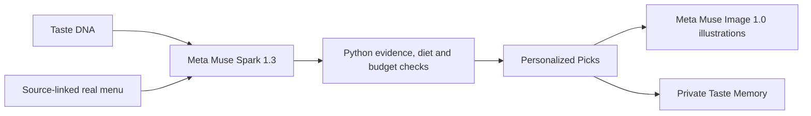
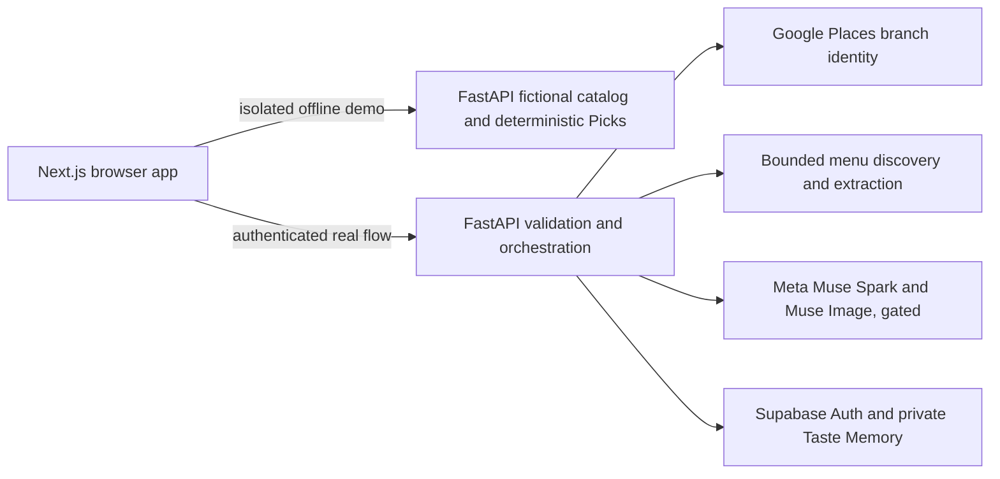

# DineTuned

**DineTuned — Your Personal AI Dining Concierge**

A personalized culinary discovery experience that learns your tastes and helps you decide what to order.

🌐 **Live Website:** https://www.dinetuned.com

🍽️ **Try the Guided Demo:** https://www.dinetuned.com/demo

**Powered by Meta Muse.** In approved live sessions, Muse Spark 1.3 reasons over Taste DNA and a source-linked restaurant menu to suggest personalized dishes. Muse Image 1.0 creates clearly labeled illustrative food imagery for validated Picks.

The fully functional guided demo uses fictional menus and deterministic recommendations; it does not make live Meta requests. Live Meta inference is disabled on the public deployment. DineTuned is built with Next.js and FastAPI for the 2026 Meta AI Developer Hackathon.

## How to Experience DineTuned

1. Complete **Taste Detective** to explore your food preferences, then review your **Taste DNA**.
2. Browse a fictional demo restaurant or, when live search is enabled, select a real restaurant. Explore its full categorized menu.
3. Choose **Find My Personal Picks** to enter Muse's Test Kitchen and see personalized dish suggestions, TasteBridge connections, and meal ideas.
4. Save, try, and rate dishes, then revisit your choices in **Taste Memory**. Demo interactions stay separate from real guest data.

## What Meta's models power

**Meta Muse Spark 1.3** is the culinary reasoner for approved real-menu sessions. DineTuned sends a bounded Taste DNA, guest preferences, the selected restaurant, and source-linked menu item IDs, names, descriptions and prices. Muse Spark proposes dish matches, taste/evidence connections and meal ideas; [Python validation](api/app/real_picks/validation.py) checks menu identity, evidence, restrictions, allergies and exact budget calculations, then assembles grounded guest-facing explanations. The [provider](api/app/real_picks/provider.py) uses the guarded [Meta transport](api/app/culinary/meta.py).

**Meta Muse Image 1.0** creates optional, dish-specific illustrations from an approved Pick's actual menu name and supported description. The [image pipeline](api/app/real_picks/illustrations.py) stores them in a private cache; the app labels them as AI-generated illustrations, not restaurant photographs. Images are fetched separately so Picks do not wait for artwork.



The **offline guided demo** uses six fictional menus and a deterministic local recommendation engine. It demonstrates the same Explore, categorized-menu and Picks components without claiming fresh model inference. Genuine provider calls require authenticated, signed context and explicit owner-enabled spending policy; they remain disabled by default. [How It Works](web/app/how-it-works/page.tsx) makes this distinction visible in the product. See [model setup and credit controls](docs/META_4D1.md), [real-menu Picks](docs/META_PICKS_4D5A.md), and [Muse Image safeguards](docs/MUSE_IMAGE_LOCAL.md) for legitimate live configuration.

## Try the complete offline demo

Node.js 20.9+ and Python 3.11+ are required. No Google, Meta, Supabase, API key, or account is needed. The local FastAPI server supplies the fictional catalog, preference checks, and deterministic Picks.

```bash
cd api
python3 -m venv .venv
source .venv/bin/activate
python -m pip install -r requirements.txt
python -m uvicorn app.main:app --host 127.0.0.1 --port 8000
```

In another terminal:

```bash
cd web
npm ci
npm run dev
```

Open **[http://localhost:3000/demo](http://localhost:3000/demo)**, or open the home page and choose **Try DineTuned Demo**. Choose the labeled sample palate for a quick start, or complete Taste Detective with your own answers. **Find a restaurant** opens the original Explore directory. Its six distinct fictional restaurants each have 20 original dishes in seven cuisine-appropriate categories. Choose one to use the original full-menu and redesigned Picks pages. Offline Picks are computed for the current demo palate and restrictions; they are not fresh Muse Spark output. The cinematic Test Kitchen uses that menu's actual fixture dish names. The isolated demo uses `sessionStorage` for Taste DNA and dining actions, and never writes to the real guest account or invokes Google or Meta. **Restart demo** clears only the isolated demo; **Exit demo · Real restaurants** returns to the normal account context.

The guided path covers Taste Detective → Taste DNA → original Explore → fictional restaurant → complete categorized menu → four-act Test Kitchen replay → up to three supported Picks → TasteBridge → Complete My Table → refinements → Save/Tried/rating → isolated Taste Memory. A strict restriction or allergy may leave fewer or no supported Picks; no dietary or allergy suitability is guaranteed by the fixture.

For the local recording tools, start Next.js with `DINETUNED_TEST_KITCHEN_PREVIEW=true npm run dev`. Then visit `/test-kitchen-preview` (also available at `/culinary-orbit-preview`) for an offline cinematic replay and `/picks-preview` for the standalone editorial Picks page. These preview routes require a localhost host and are disabled without that flag. See the [recording checklist](docs/RECORDING_CHECKLIST.md).

## Run the full application

The normal real-restaurant journey also needs Python 3.11+ and FastAPI. In another terminal:

```bash
cd api
python3 -m venv .venv
source .venv/bin/activate
python -m pip install -r requirements.txt
python -m uvicorn app.main:app --host 127.0.0.1 --port 8000
```

The frontend's same-origin `/api/dinetuned/*` relay uses `DINETUNED_API_URL=http://127.0.0.1:8000` by default. The demo calls only the local fictional catalog and deterministic recommendation endpoints. [web/.env.example](web/.env.example) and [api/.env.example](api/.env.example) show optional configuration without credentials. Put real values only in Git-ignored local files or deployment secrets; never commit them.

Real integrations are deliberately separate from the fictional demo:

- **Google Places (New)** finds an exact restaurant branch using a backend-only key, session controls, request limits, and signed selection. Live search is disabled unless explicitly configured and enabled. [Setup](docs/GOOGLE_PLACES_4D3.md).
- **Menu source discovery and extraction** use signed branch/source authorization, bounded site fetching or user-uploaded HTML/text-PDF, source hashes, price variants, and incompleteness notices. Scanned pages need later vision support. [Discovery](docs/MENU_SOURCES_4D4A.md), [extraction](docs/MENU_EXTRACTION_4D4B.md), [frontend](docs/REAL_MENU_FRONTEND_4D4C.md).
- **Muse Spark 1.3** proposes real-menu Picks; Python validates menu IDs, source evidence, restrictions, prices, and budget positions. Live dispatch requires a verified guest, signed menu, explicit production policy, and local spending preflight. It is **off by default**. [Model integration](docs/META_PICKS_4D5A.md), [credit controls](docs/META_4D1.md).
- **Muse Image 1.0** can create and cache clearly labeled dish illustrations through a separate guarded path; the offline demo uses local original illustrations. [Image safeguards](docs/MUSE_IMAGE_LOCAL.md).
- **Supabase Auth/PostgreSQL** supports real guest identity, Taste DNA backup, private dining actions, ratings, and Taste Memory with RLS. The isolated demo does not touch Supabase. [Setup](docs/SUPABASE_4D2A.md), [history](docs/SUPABASE_4D2B.md).



The real journey needs configured services and a verified menu. It never substitutes fictional dishes for a real restaurant. Unknown ingredients are not treated as verified safe. The full offline demo is the reproducible judge path; it is **not** a claim of fresh Muse Spark inference.

## Screenshots

Captured from the isolated fictional demo at 1280 × 720. These show offline, deterministic sample content, not live provider results.

| Stage | Capture |
| --- | --- |
| [Welcome](docs/screenshots/demo-welcome.png) | [Taste DNA](docs/screenshots/demo-taste-dna.png) |
| [Original Explore, six fictional venues](docs/screenshots/demo-explore.png) | [Categorized menu](docs/screenshots/demo-menu.png) and [dish prices](docs/screenshots/demo-menu-items.png) |
| [Personalized Picks](docs/screenshots/demo-picks.png) | [Isolated Taste Memory](docs/screenshots/demo-memory.png) |

## Reproducibility and provenance

Run focused checks with `cd web && npm run typecheck`, `cd api && .venv/bin/python -m pytest -q tests/test_api.py tests/test_pairing.py`, and `cd web && npx playwright test tests/e2e/final-demo.spec.ts --project=desktop --project=mobile` with both local servers running. A local Chrome/Chromium installation is needed for browser tests.

The [hackathon contribution record](docs/HACKATHON_SUBMISSION.md) distinguishes pre-window starter work from Oct 26–Nov 4 additions. [NOTICE](NOTICE.md) explains assets and third-party marks. Original project code is offered under the [MIT License](LICENSE); Google's attribution asset and provider trademarks are excluded.

This public repository is a clean source export of private development commit `a5ebb4c`, not a claim that all work was created on the export commit date. The contribution record documents the earlier starter and hackathon work.
