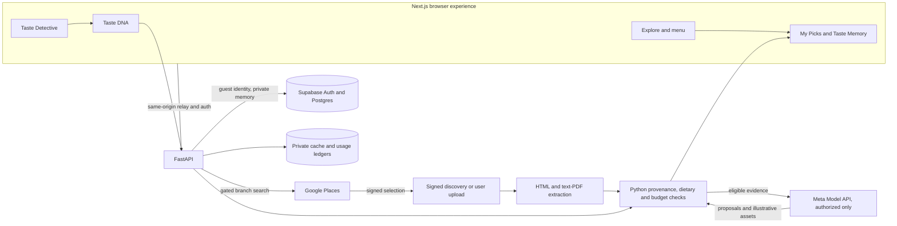
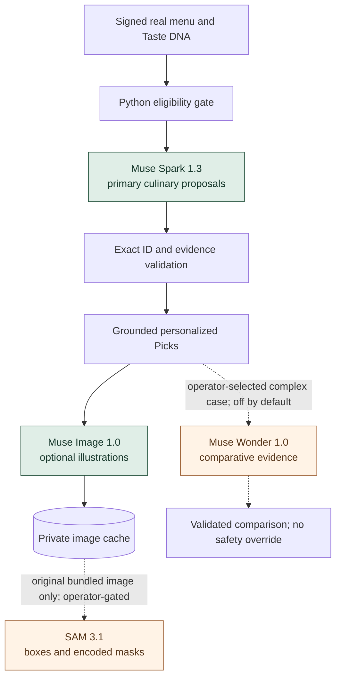
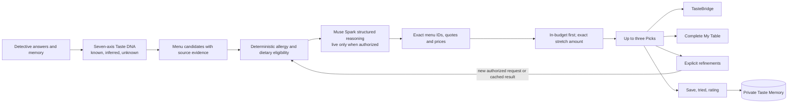

# DineTuned — Your Personal AI Dining Concierge

**A personal palate meets a real restaurant menu.** DineTuned builds a persistent, evidence-aware picture of what someone enjoys, then helps them decide **what to order** at a particular restaurant. Taste Detective elicits preferences; Taste DNA keeps known, inferred, and unknown signals distinct; menu provenance keeps recommendations attached to actual dishes. Muse's Test Kitchen turns that reasoning into an editorial dining experience.

🎬 **[Watch the DineTuned Demo Video](https://drive.google.com/file/d/1buOEbuX-TYIbjsvw9RD9CRqwz9q8ukzn/view?usp=sharing)**

🌐 **Live website:** https://www.dinetuned.com

🍽️ **Guided demo:** https://www.dinetuned.com/demo

The public demo is fully usable without provider credentials: **six fictional restaurants, 120 original dishes, local images, and deterministic or prepared personalization.** It makes **no fresh Meta or Google request**. The authorized real-restaurant path has previously exercised Muse Spark 1.3 and Muse Image 1.0, but paid Google and Meta dispatch are **disabled on the public deployment**.

## Experience the product

1. Meet **Taste Detective**, choose food preferences, and inspect your seven-dimensional **Taste DNA**. Unanswered qualities stay unknown.
2. Browse a categorized fictional menu in the guided demo, or use the separately gated real-restaurant search and signed menu ingestion path.
3. Choose **Find My Personal Picks**. Muse's Test Kitchen introduces the palate and current menu; the same editorial Picks interface presents grounded dishes, TasteBridge, meal additions, budget alternatives, and refinements.
4. Save, mark tried, and rate dishes; revisit them in **Taste Memory**. Demo state is isolated from real guest data.

## Meta Model API: intelligence with an evidence boundary

| Model | Responsibility and concrete I/O | Integration | Status |
| --- | --- | --- | --- |
| **Muse Spark 1.3** (`muse-spark-1.3`) | Receives bounded Taste DNA, preference evidence, eligible item IDs, prices, descriptions, and source facts. Proposes up to three matches, taste connections, and meal ideas as structured JSON. | [Guarded transport](api/app/culinary/meta.py) → [real Picks provider](api/app/real_picks/provider.py) → [Python validation](api/app/real_picks/validation.py) | **Implemented and live-tested** in authorized private sessions; public paid dispatch off. |
| **Muse Wonder 1.0** (`muse-wonder-1.0`) | Optionally compares two or more *existing* grounded Picks for a complex choice. Receives the same signed menu context, selected eligible items, and supported preference IDs; returns exact item quotes and preference references for validation. | [Optional comparison adapter](api/app/optional_models/wonder.py), [operator CLI](api/scripts/optional_meta.py) | **Implemented, mocked and gated; not live-validated.** No public route or automatic latency in normal Picks. |
| **Muse Image 1.0** (`muse-image-1.0`) | Receives a validated Pick's dish name and source-supported description; returns a labeled, private, cached **illustration**, never claimed as restaurant photography. | [Image generation and cache](api/app/real_picks/illustrations.py) | **Implemented and live-tested** in authorized private sessions; public paid dispatch off. |
| **SAM 3.1** (`sam-3.1`) | Optionally receives one original bundled food JPEG and a bounded noun-phrase prompt (`food` or `plate`). Returns object boxes and encoded segmentation masks. It does **not** identify a dish, ingredient, allergen, or menu price. | [Optional still-image adapter](api/app/optional_models/sam.py), [operator CLI](api/scripts/optional_meta.py) | **Implemented for still images, mocked and gated; not live-validated.** No public route or overlay UI. |

Identifiers, endpoint behavior, and [current prices](https://dev.meta.ai/docs/pricing-rate-limits) were checked against Meta's [model catalog](https://dev.meta.ai/docs/models), [reasoning guidance](https://dev.meta.ai/docs/reasoning), and [SAM request](https://dev.meta.ai/docs/sam/segmenting) / [output grammar](https://dev.meta.ai/docs/sam/reading-segmentation) on November 4, 2026. Price checks expire in code; deployment must re-verify rates before later live use. The optional adapters are **integration paths**, not evidence of successful Wonder or SAM provider inference.

### End-to-end service architecture



The offline path uses the same browser components, FastAPI surface, and fictional menu catalog without Google or Meta. In the real path, a Google result is a branch candidate; signed selection binds a specific place and address before discovery or upload. Extracted menu items retain source, document, page or element evidence and price uncertainty. A valid menu is necessary for new real Picks, and an expired token can leave previously authorized results read-only.

### Four-model orchestration and runtime status



Solid model paths are implemented and previously live-tested in controlled private sessions. Dotted paths are backend-only, opt-in, **mock-tested but never live-validated**. Wonder does not replace Spark; SAM does not create the underlying image. The code, not any model, authorizes calls, preserves identity, enforces dietary exclusions, calculates money, or writes Taste Memory.

### Personalized recommendation pipeline



**Why separate reasoning from enforcement?** Culinary similarity across cuisines is probabilistic; a signed branch, an actual menu item, a quoted source fact, a hard allergy exclusion, and a dollar calculation are checkable invariants. DineTuned lets Meta reason about *fit* but accepts only outputs that Python can trace back to the chosen menu and known preferences. Unknown Taste DNA values are not filled with guesses; unknown ingredients are not declared safe. This makes a smaller, honest result preferable to three fabricated recommendations.

## Engineering the real menu journey

- **Preference elicitation:** [Taste Detective](web/lib/detective/engine.ts) derives sensory signals from actual answers. [Taste DNA](web/app/taste/page.tsx) presents seven dimensions with evidence and unknown handling; [Taste Memory](api/app/real_picks/memory.py) contributes confirmed dining feedback without rewriting the person's history.
- **Branch and menu provenance:** [Google Places identity](api/app/menu_sources/identity.py) signs the selected branch; [source discovery](api/app/menu_sources/agent.py) uses bounded fetching. [HTML](api/app/menu_extraction/html.py) and [text-PDF](api/app/menu_extraction/pdf.py) parsers normalize categories, item IDs, descriptions, prices, currency, and source references. [Upload](api/app/menu_extraction/upload.py) is a recovery path; user-provided documents are labeled accordingly. Scanned images remain unsupported without a verified vision extraction path.
- **Recommendation contracts:** [Context construction](api/app/real_picks/context.py) selects eligible dishes and evidence for the [structured Muse request](api/app/culinary/meta.py). [Validation](api/app/real_picks/validation.py) rejects ungrounded IDs, invented facts, invalid dietary claims, and price changes. [Pipeline](api/app/real_picks/pipeline.py) assembles up to three supported Picks and their explanations. [TasteBridge](api/app/tastebridge/service.py) connects a supported familiar taste to a new menu discovery without inventing a prior meal.
- **Budget and table:** [Real Picks validation](api/app/real_picks/validation.py) applies per-dish budget rules, names any exact over-budget difference, and validates pairing IDs and combined totals. Refinements remain explicit actions, preserve permanent restrictions, and reuse the guarded inference/cache path. The product estimates a meal subtotal; it does not place an order.
- **Illustration and optional vision:** [Muse Image](api/app/real_picks/illustrations.py) runs asynchronously after valid Picks and caches assets privately; labels distinguish illustrations from restaurant photography. Optional [SAM](api/app/optional_models/sam.py) isolates geometry from an original demo asset and retains its encoded mask. There is no ingredient recognition, OCR, or public segmentation UI.
- **Guest privacy and cost:** Supabase authentication and row-level security protect real Taste DNA and memory. Signed restaurant/menu context and per-guest [private results](api/app/real_picks/table_store.py) prevent cross-guest reuse. The [production gate](api/app/real_picks/production_gate.py), [locked cumulative ledger](api/app/usage_budget.py), and [validation-phase guard](api/app/validation_spend.py) reserve cost before dispatch; unknown outcomes retain their reservation. Idempotent caches avoid duplicate paid work. A local estimate is **not** a provider billing guarantee.

### What Meta contributes, and what remains application code

Muse Spark supplies the cross-cuisine judgment: interpreting a person's sensory profile against *this* restaurant's evidenced dishes, selecting strong matches, and proposing TasteBridge and table connections. Muse Wonder adds an optional second lens for close, ambiguous comparisons, bounded to already valid Picks. Muse Image makes an unfamiliar dish visually approachable with labeled illustrative art. SAM can isolate visible foreground regions in original food artwork for future presentation experiments. These are distinct capabilities on Meta Model API, composed around one evidence contract. Python and Supabase still own the trust boundary: eligibility, exact dish and price identity, allergy and dietary safeguards, authorization, budget arithmetic, cache isolation, spending records, and feedback persistence.

### Reproducible modes and optional model checks

| Mode | What runs | What is deliberately absent |
| --- | --- | --- |
| **Offline guided demo** | Six fictional restaurants, 120 dishes, local sample images, prepared or deterministic Picks, isolated demo memory. | No Google search, fresh Meta inference, real restaurant claim, or provider charge. |
| **Authorized real workflow** | Signed restaurant selection; source or uploaded menu extraction; genuine Muse Spark and optional Muse Image after server-side policy and consent. | No fictional fallback in a real restaurant. Public paid dispatch remains disabled. |
| **Operator-only optional checks** | Muse Wonder comparison of existing signed Picks; SAM still-image segmentation of whitelisted original demo assets. | No public API route or UI, no default dispatch, no claim of live validation. |

Run the optional mocked tests with `cd api && python -m pytest -q tests/test_optional_meta_models.py`. The operator CLI is [api/scripts/optional_meta.py](api/scripts/optional_meta.py); it rejects any live command without **both** `--live` and `--confirm-spend`. A live Wonder comparison additionally needs a current signed request/result for the *same authenticated guest*, a genuine saved Muse Spark result, `MODEL_API_KEY`, `DINETUNED_MUSE_WONDER_ENABLED=true`, and a separate owner-approved `DINETUNED_MUSE_WONDER_APPROVAL_ID`, `CAP_USD`, and `MAX_ATTEMPTS`. SAM needs an approved `DINETUNED_SAM_*` policy, a whitelisted original JPEG, and the same explicit CLI consent. Both use the shared locked Meta ledger and are off by default; obtaining credentials alone enables nothing. Check Meta's current account access and rates before any approved live test. [Example backend variables](api/.env.example) contain no secrets.

## Guided demo setup

Node.js 20.9+ and Python 3.11+ are required. No Google, Meta, Supabase, API key, or account is needed. The local FastAPI server supplies the fictional catalog, preference checks, and deterministic Picks.

```bash
cd api
python3 -m venv .venv
source .venv/bin/activate
python -m pip install -r requirements.txt
python -m uvicorn app.main:app --host 127.0.0.1 --port 8000
```

In another terminal:

```bash
cd web
npm ci
npm run dev
```

Open **[http://localhost:3000/demo](http://localhost:3000/demo)**, or open the home page and choose **Try DineTuned Demo**. Choose the labeled sample palate for a quick start, or complete Taste Detective with your own answers. **Find a restaurant** opens the original Explore directory. Its six distinct fictional restaurants each have 20 original dishes in seven cuisine-appropriate categories. Choose one to use the original full-menu and redesigned Picks pages. Offline Picks are computed for the current demo palate and restrictions; they are not fresh Muse Spark output. The cinematic Test Kitchen uses that menu's actual fixture dish names. The isolated demo uses `sessionStorage` for Taste DNA and dining actions, and never writes to the real guest account or invokes Google or Meta. **Restart demo** clears only the isolated demo; **Exit demo · Real restaurants** returns to the normal account context.

The guided path covers Taste Detective → Taste DNA → original Explore → fictional restaurant → complete categorized menu → four-act Test Kitchen replay → up to three supported Picks → TasteBridge → Complete My Table → refinements → Save/Tried/rating → isolated Taste Memory. A strict restriction or allergy may leave fewer or no supported Picks; no dietary or allergy suitability is guaranteed by the fixture.

For the local recording tools, start Next.js with `DINETUNED_TEST_KITCHEN_PREVIEW=true npm run dev`. Then visit `/test-kitchen-preview` (also available at `/culinary-orbit-preview`) for an offline cinematic replay and `/picks-preview` for the standalone editorial Picks page. These preview routes require a localhost host and are disabled without that flag. See the [recording checklist](docs/RECORDING_CHECKLIST.md).

## Run the full application

The normal real-restaurant journey also needs Python 3.11+ and FastAPI. In another terminal:

```bash
cd api
python3 -m venv .venv
source .venv/bin/activate
python -m pip install -r requirements.txt
python -m uvicorn app.main:app --host 127.0.0.1 --port 8000
```

The frontend's same-origin `/api/dinetuned/*` relay uses `DINETUNED_API_URL=http://127.0.0.1:8000` by default. The demo calls only the local fictional catalog and deterministic recommendation endpoints. [web/.env.example](web/.env.example) and [api/.env.example](api/.env.example) show optional configuration without credentials. Put real values only in Git-ignored local files or deployment secrets; never commit them.

Real integrations are deliberately separate from the fictional demo:

- **Google Places (New)** finds an exact restaurant branch using a backend-only key, session controls, request limits, and signed selection. Live search is disabled unless explicitly configured and enabled. [Setup](docs/GOOGLE_PLACES_4D3.md).
- **Menu source discovery and extraction** use signed branch/source authorization, bounded site fetching or user-uploaded HTML/text-PDF, source hashes, price variants, and incompleteness notices. Scanned pages need later vision support. [Discovery](docs/MENU_SOURCES_4D4A.md), [extraction](docs/MENU_EXTRACTION_4D4B.md), [frontend](docs/REAL_MENU_FRONTEND_4D4C.md).
- **Muse Spark 1.3** proposes real-menu Picks; Python validates menu IDs, source evidence, restrictions, prices, and budget positions. Live dispatch requires a verified guest, signed menu, explicit production policy, and local spending preflight. It is **off by default**. [Model integration](docs/META_PICKS_4D5A.md), [credit controls](docs/META_4D1.md).
- **Muse Image 1.0** can create and cache clearly labeled dish illustrations through a separate guarded path; the offline demo uses local original illustrations. [Image safeguards](docs/MUSE_IMAGE_LOCAL.md).
- **Supabase Auth/PostgreSQL** supports real guest identity, Taste DNA backup, private dining actions, ratings, and Taste Memory with RLS. The isolated demo does not touch Supabase. [Setup](docs/SUPABASE_4D2A.md), [history](docs/SUPABASE_4D2B.md).

The real journey needs configured services and a verified menu. It never substitutes fictional dishes for a real restaurant. Unknown ingredients are not treated as verified safe. The full offline demo is the reproducible judge path; it is **not** a claim of fresh Muse Spark inference.

## Repository and deployment

| Path | Responsibility |
| --- | --- |
| [`web/`](web) | Next.js consumer interface, isolated guided demo, Taste Detective and Taste DNA, cinematic Test Kitchen, menus, Picks, and private relay. |
| [`api/app/`](api/app) | FastAPI catalog, signed restaurant/menu flow, deterministic validation, guarded model adapters, private caches and memory. |
| [`api/tests/`](api/tests), [`web/tests/`](web/tests) | Offline contract, safety, provider-mock, and browser regression checks. |
| [`docs/`](docs) | Feature decisions, deployment, provenance, model safeguards, screenshots, and hackathon contribution record. |
| [`render.yaml`](render.yaml) | Single-instance Render backend with a persistent private disk; the web app is configured separately on Vercel. |

The [deployment guide](docs/DEPLOYMENT_MVP.md) describes Render, Vercel, Supabase, and DNS configuration. Preserve the signing key, private caches, and locked usage ledger on durable storage; do not scale the file-backed backend across independent instances without shared state. The checked-in Render configuration leaves Google, Spark, and Muse Image off. Wonder and SAM additionally default off in the backend and have no public route. Environment examples list names only; provider keys belong in backend secrets, never the repository or browser.

## Screenshots

Captured from the isolated fictional demo at 1280 × 720. These show offline, deterministic sample content, not live provider results.

| Stage | Capture |
| --- | --- |
| [Welcome](docs/screenshots/demo-welcome.png) | [Taste DNA](docs/screenshots/demo-taste-dna.png) |
| [Original Explore, six fictional venues](docs/screenshots/demo-explore.png) | [Categorized menu](docs/screenshots/demo-menu.png) and [dish prices](docs/screenshots/demo-menu-items.png) |
| [Personalized Picks](docs/screenshots/demo-picks.png) | [Isolated Taste Memory](docs/screenshots/demo-memory.png) |

## Reproducibility and provenance

Run focused checks with `cd web && npm run typecheck`, `cd api && .venv/bin/python -m pytest -q tests/test_api.py tests/test_pairing.py`, and `cd web && npx playwright test tests/e2e/final-demo.spec.ts --project=desktop --project=mobile` with both local servers running. A local Chrome/Chromium installation is needed for browser tests.

The [hackathon contribution record](docs/HACKATHON_SUBMISSION.md) distinguishes pre-window starter work from Oct 26–Nov 4 additions. [NOTICE](NOTICE.md) explains assets and third-party marks. Original project code is offered under the [MIT License](LICENSE); Google's attribution asset and provider trademarks are excluded.

This public repository is a clean source export of private development commit `a5ebb4c`, not a claim that all work was created on the export commit date. The contribution record documents the earlier starter and hackathon work.
